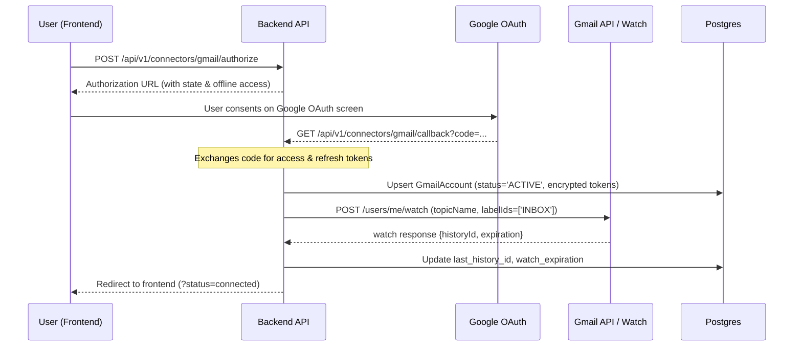
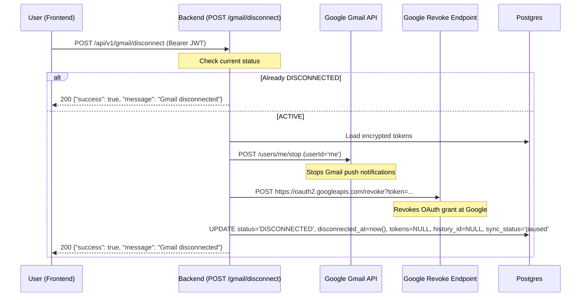

# Gmail Connect & Disconnect Lifecycle Architecture

This document details the complete connect, disconnect, and reconnect lifecycle for Gmail mailbox monitoring in CYBERGUARD.

---

## 1. Overview & Architecture

CYBERGUARD integrates with Google Gmail via OAuth 2.0 and Google Cloud Pub/Sub push notifications. The integration is designed with the following security and operational guarantees:

- **Per-User Isolation**: Each user connects their own Gmail mailbox via OAuth 2.0 with the `gmail.modify` scope.
- **Shared Pub/Sub Infrastructure**: All mailboxes publish push notifications to a shared Google Cloud Pub/Sub topic. Disconnecting an individual user never modifies or deletes shared cloud infrastructure.
- **Defense in Depth**: Access and refresh tokens are encrypted at rest using Fernet encryption (`app.core.crypto`). Stored tokens are **never** returned to the client or frontend.
- **Idempotency**: All lifecycle endpoints (`/gmail/disconnect`, `/gmail/status`, webhook ingestion) are strictly idempotent. Repeated calls succeed without duplicate side-effects.

---

## 2. Connect Flow



1. **Authorization Initiation**:
   - The user clicks **Connect Gmail** on either the Settings page or Email Connectors page.
   - The backend creates an OAuth state with cryptographic verification and returns the Google OAuth consent URL.
   - `prompt=consent` and `access_type=offline` ensure Google issues a refresh token on first authorization.

2. **Callback & Credential Storage**:
   - Google redirects to `/api/v1/connectors/gmail/callback`.
   - The authorization code is exchanged for an access token and refresh token.
   - Tokens are encrypted with Fernet (`encrypt_secret`) and stored in `cyberguard.gmail_accounts` (`status='ACTIVE'`, `disconnected_at=NULL`).
   - Push monitoring is initialized via `GmailClient.watch()`, which registers push notifications to the shared Google Pub/Sub topic and stores the initial `historyId` and `watch_expiration`.

---

## 3. Disconnect Flow

When a user disconnects Gmail, CYBERGUARD performs graceful resource cleanup:



### Steps in `POST /gmail/disconnect`:
1. **Authentication & Account Resolution**:
   - Resolves `GmailAccount` where `owner_user_id == current_user.id`.
   - Returns `404 Not Found` if no account is registered.
2. **Idempotency Gate**:
   - If `account.status == 'DISCONNECTED'`, immediately returns `{"success": true, "message": "Gmail disconnected"}` without calling any external Google APIs.
3. **Stop Push Watch**:
   - Calls `POST https://gmail.googleapis.com/gmail/v1/users/me/stop` via `GmailClient.stop()`.
   - Any errors (e.g. watch already expired or stopped) are caught and logged; cleanup continues.
4. **Token Revocation**:
   - Calls `POST https://oauth2.googleapis.com/revoke` with the user's refresh token (or access token).
   - Any network or HTTP errors are caught; failure does not block database cleanup.
5. **Credential Purging**:
   - Clears stored credentials: `refresh_token_encrypted = NULL`, `access_token_encrypted = NULL`.
   - Clears checkpoints: `last_history_id = NULL`, `watch_expiration = NULL`.
   - Updates status: `status = 'DISCONNECTED'`, `disconnected_at = now()`, `sync_status = 'paused'`.
   - Marks mirrored connector: `EmailConnectorAccount.status = 'revoked'`.
   - Commits transaction to database.

---

## 4. Reconnect Flow

When a previously disconnected user reconnects their Gmail account:

1. **Row Reuse (No Duplication)**:
   - `get_or_create_gmail_account` queries `(owner_user_id, email)`.
   - When the disconnected row exists, it updates the existing row instead of inserting a duplicate row.
2. **State Reactivation**:
   - `status` is set to `'ACTIVE'`.
   - `disconnected_at` is reset to `NULL`.
   - `sync_status` is reset to `'active'`, `last_error` is cleared.
   - New `access_token` and `refresh_token` are encrypted and stored.
3. **Fresh Checkpoint**:
   - `GmailClient.watch()` is called to register push notifications with Google.
   - The returned `historyId` replaces the checkpoint in the database.
   - Previous history entries are not replayed.

---

## 5. Worker & Webhook Guards

To prevent stale or late-arriving Pub/Sub push messages from triggering unauthorized email fetching or scanning after disconnect, guards are enforced at two levels:

1. **Webhook Gate (`/webhooks/gmail`)**:
   - The webhook checks `account.status == 'ACTIVE'`.
   - If `status == 'DISCONNECTED'`, the push notification is immediately acknowledged with `{"status": "ignored", "reason": "account_disconnected"}`. No sync job is queued into Redis or `job_queue`.

2. **Worker Gate (`gmail_worker.py` & `sync_service.py`)**:
   - If an in-flight job was already enqueued before disconnect, the worker re-queries `GmailAccount` with row lock.
   - If `status != 'ACTIVE'`, the worker logs and skips execution, marking the job queue entry as skipped.
   - `fetch_service.py` likewise skips message fetching if `account.status != 'ACTIVE'`.

---

## 6. Status Endpoint & API Contract

### `GET /gmail/status`
Returns connection status for the authenticated user without exposing any sensitive tokens or internal IDs:

#### Connected:
```json
{
  "connected": true,
  "email": "analyst@example.com",
  "status": "ACTIVE"
}
```

#### Disconnected:
```json
{
  "connected": false,
  "email": null,
  "status": "DISCONNECTED"
}
```

### `POST /gmail/disconnect`
```json
{
  "success": true,
  "message": "Gmail disconnected"
}
```

---

## 7. Frontend Lifecycle & State Transitions

The frontend UI (`Settings.tsx`, `EmailConnectors.tsx`, `useGmailStatus.ts`) follows the state contract:

```
[Loading]
   │
   ▼
[Not Connected / Disconnected]
   │
   ├── (Click "Connect Gmail") ──► [Connecting...] ──► [OAuth Redirect] ──► [Connected]
   │                                                                           │
   ▼                                                                           │
[Disconnected] ◄── [Disconnecting...] ◄── (Confirm Modal) ◄── (Click "Disconnect")
```

- **Confirmation Modal**:
  Required warning displayed prior to disconnect:
  *"This will stop Gmail monitoring, remove stored credentials, and disable email scanning. You can reconnect later."*
- **Error Handling**:
  If the network request fails, displays *"Unable to disconnect. Please try again."* without leaking raw technical stack traces.
